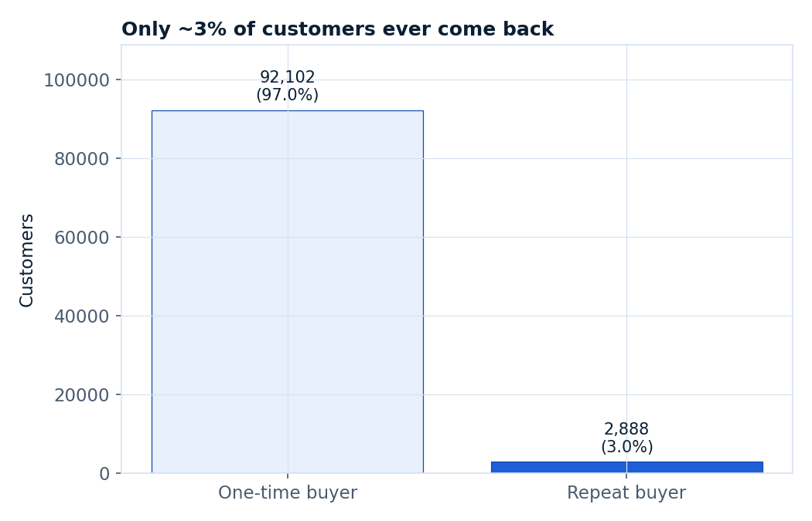
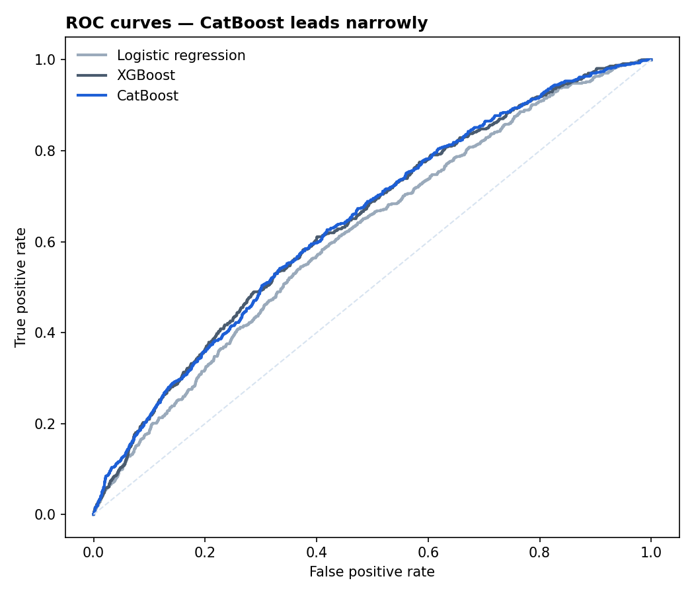
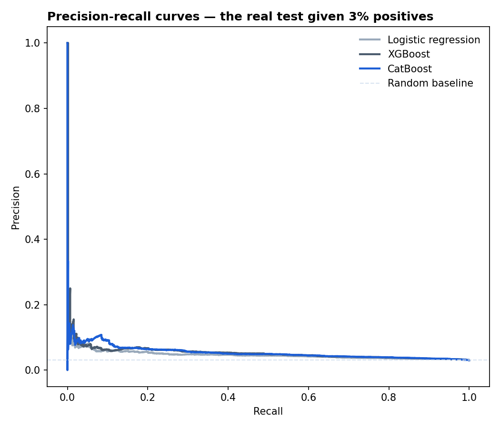
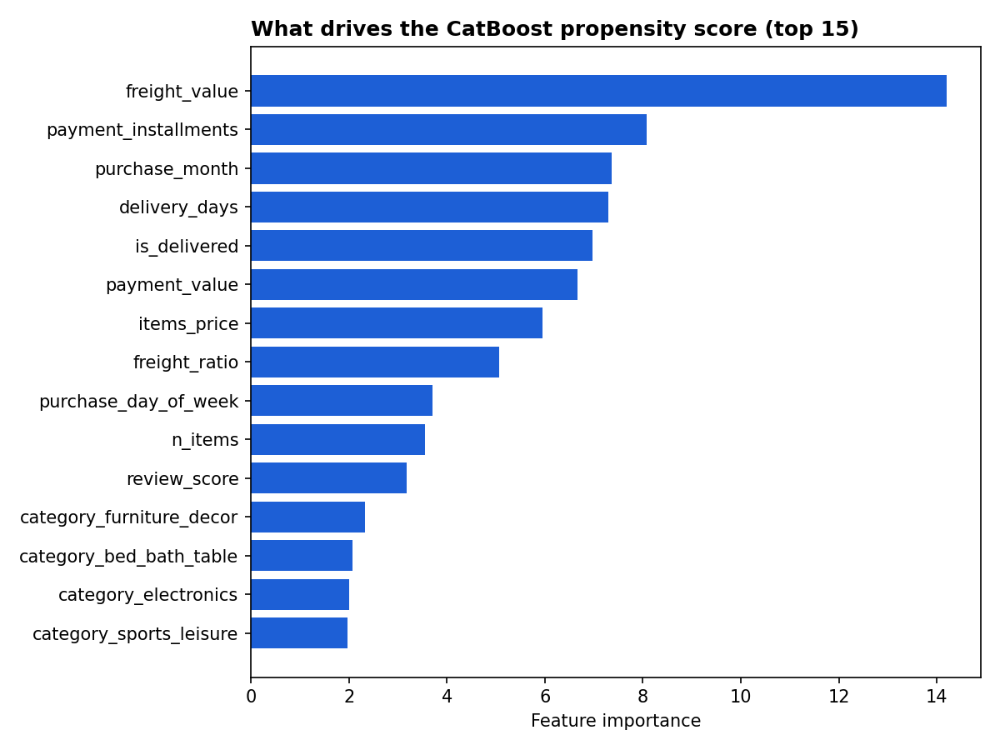
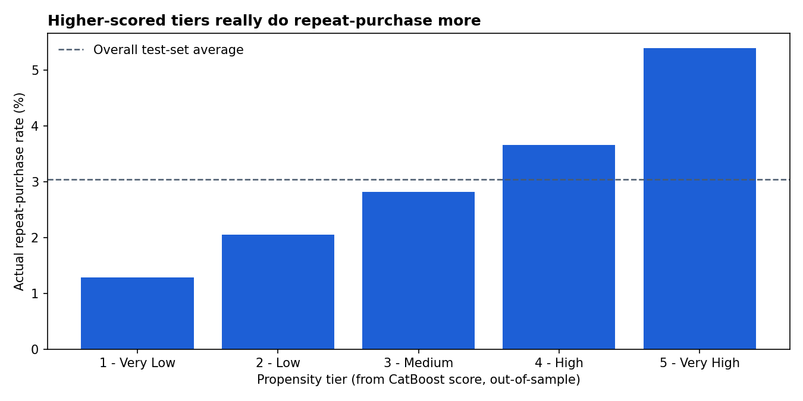
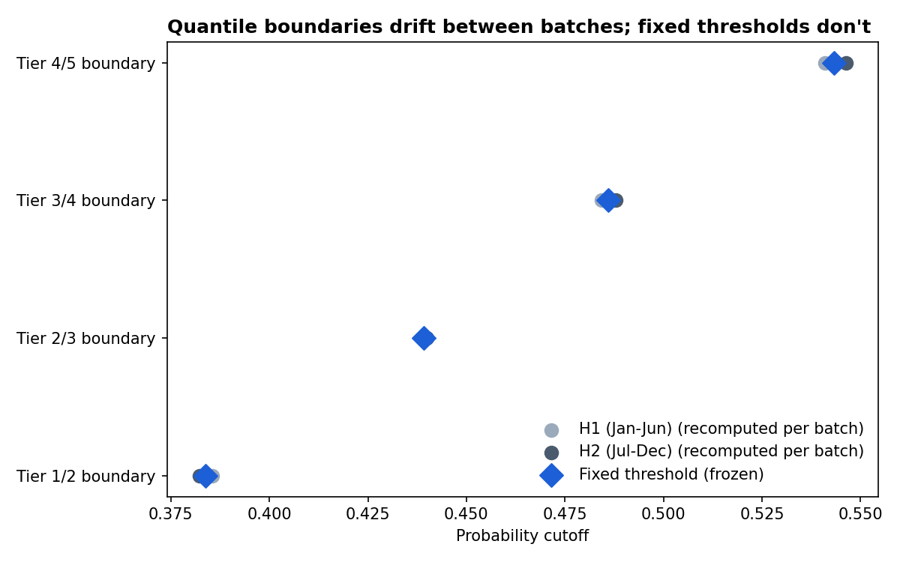

# Lead Scoring — Customer Repeat-Purchase Propensity

> ML lead scoring pipeline that predicts a customer's propensity to buy again from their first-order profile, comparing XGBoost vs. CatBoost and segmenting customers into 5 propensity tiers using fixed, production-stable probability thresholds instead of per-batch quantiles.

## Problem

Sales and CRM teams need to prioritize which customers are worth pursuing for retention or upsell campaigns. This project builds a propensity score from a customer's very first purchase — before any repeat behavior is observed — and turns it into 5 actionable tiers a marketing team could act on directly.

## Data Source

[Brazilian E-Commerce Public Dataset by Olist](https://www.kaggle.com/datasets/olistbr/brazilian-ecommerce) — the same dataset used in the companion [retail-sales-forecasting](https://github.com/abatista346/retail-sales-forecasting) repo, reframed here around individual customer behavior instead of aggregate demand. Data © Olist, released publicly on Kaggle under its dataset terms.

Not included in this repository (raw CSVs are gitignored). See [Setup](#setup) to fetch it yourself.

## Solution

This dataset has no traditional "leads" — every customer already completed a purchase. The propensity target is therefore defined as: **will this customer place a second order?**, predicted using only information available from their **first order** (so nothing about the second order leaks into the features).

1. **Ingestion** (`src/ingest.py`) — pulls the dataset via `kagglehub`.
2. **Preprocessing** (`src/preprocessing.py`) — builds one row per unique customer from their first order only (basket size, category, payment, delivery, review), with a `target_repeat_purchase` flag from whether they placed a second non-canceled order.
3. **EDA** (`notebooks/eda_storytelling.ipynb`) — checks which first-order signals actually predict repeat behavior.
4. **Feature engineering** (`src/feature_engineering.py`) — imputation, one-hot encoding, and a single stratified 80/20 train/test split reused by every model.
5. **Baselines** (`src/train_baseline.py`) — majority-class and class-weighted logistic regression.
6. **XGBoost** (`src/train_xgboost.py`) and **CatBoost** (`src/train_catboost.py`) — gradient boosting classifiers on the identical feature set, for a fair library comparison.
7. **Segmentation** (`src/segment_customers.py`) — buckets the winning model's out-of-sample scores into 5 propensity tiers using **fixed probability thresholds**, not per-batch quantiles (see below for why).
8. **Evaluation** (`src/evaluate_models.py`) — ROC/PR curve comparison and feature importance.
9. **Tier stability analysis** (`src/tier_stability_analysis.py`) — quantifies the instability fixed thresholds avoid, versus recomputing quantiles per scoring batch.

## Tech Stack

Python, pandas, scikit-learn, XGBoost, CatBoost, matplotlib, Jupyter, kagglehub

## Key Findings (EDA)



- **Severe class imbalance**: only 3.04% of customers (2,888 of 94,990) ever place a second order — accuracy is a useless metric here; the majority-class baseline hits 97% accuracy while doing nothing.
- **Basket size is the strongest single signal**: customers who bought 4+ items in their first order repeat at roughly double the rate of single-item buyers.
- **Category effects are real but modest**: furniture/home categories retain noticeably better than electronics — a ~2.5x spread.
- **No single feature is a strong standalone predictor** — even review score is weak and non-monotonic, motivating a multivariate model over simple business rules.

See the [EDA notebook](notebooks/eda_storytelling.ipynb) for the full analysis.

## Model Results

Evaluated on a held-out, stratified 20% test set (18,998 customers, same 3.04% positive rate):

| Model | ROC-AUC | PR-AUC | Accuracy |
|---|---|---|---|
| Majority-class | 0.500 | 0.030 | 97.0% |
| Logistic regression (class-weighted) | 0.613 | 0.047 | 60.1% |
| XGBoost | 0.640 | 0.054 | 68.5% |
| **CatBoost** | **0.642** | **0.054** | 65.4% |




**CatBoost narrowly wins**, so it's the model used for segmentation below. The gap between XGBoost and CatBoost is small enough that, honestly, algorithm choice matters less here than getting the imbalance handling and feature set right — both boosted models clear logistic regression by a similar margin.

Top drivers of the CatBoost score: `freight_value`, `payment_installments`, `purchase_month`, and `delivery_days` — shipping cost and payment behavior matter more than product category.



## Customer Segmentation

Even with a modest 0.642 ROC-AUC, the score **rank-orders customers well** — which is what actually matters for prioritization. Customers are split into 5 tiers by predicted propensity, scored purely on the held-out test set so every number below is genuinely out-of-sample:

| Tier | Customers | Actual repeat rate | vs. baseline |
|---|---|---|---|
| 1 – Very Low | 3,800 | 1.29% | 0.4x |
| 2 – Low | 3,799 | 2.05% | 0.7x |
| 3 – Medium | 3,800 | 2.82% | 0.9x |
| 4 – High | 3,799 | 3.66% | 1.2x |
| 5 – Very High | 3,800 | **5.39%** | **1.8x** |



Tier 5 customers repeat-purchase at 1.8x the overall rate, and 4.2x the rate of Tier 1 — a real, actionable spread a retention team could use to prioritize outreach, even though no individual first-order signal is strongly predictive on its own.

### Why fixed thresholds, not quantiles

The obvious way to build 5 tiers is `pd.qcut` — "top 20% of whatever gets scored is Tier 5." That's the wrong choice for anything scored more than once: quantile edges are computed *relative to the current batch*, so the same customer with the exact same predicted probability can land in a different tier purely because of who else was in that batch. A tier-based business rule ("call Tier 5 within 24h") stops meaning anything consistent month over month.

Instead, tier boundaries here are **fixed absolute probability cutoffs** — computed once from a reference population and then frozen, the same way you'd calibrate cutoffs once in production and reuse them on every future scoring run.

`src/tier_stability_analysis.py` measures the difference concretely: splitting the test set into customers whose first order fell in H1 (Jan–Jun) vs. H2 (Jul–Dec) — standing in for two different scoring runs — and comparing what each approach would have done:

- **Quantile edges drift between batches**: the Tier 4/5 boundary sits at p=0.541 for the H1 batch and p=0.546 for H2 — small, but real.
- **448 of 18,998 customers (2.4%) would be assigned a different tier** depending on which batch they were scored in, under the quantile approach — with an identical predicted probability.
- **Fixed thresholds give every customer the same tier regardless of batch**, by construction.



2.4% sounds small, but at scale it means thousands of customers get inconsistent treatment for no reason tied to their actual behavior — the kind of instability that erodes trust in a scoring system once it's actually running in production.

## Architecture

```
data/raw/            <- gitignored, populated by src/ingest.py
data/processed/       <- gitignored, populated by preprocessing + feature engineering
src/
  ingest.py            <- kagglehub download
  preprocessing.py     <- first-order customer table + repeat-purchase target
  feature_engineering.py <- imputation, encoding, train/test split
  train_baseline.py    <- majority-class + logistic regression
  train_xgboost.py      <- XGBoost classifier
  train_catboost.py     <- CatBoost classifier
  segment_customers.py <- 5-tier segmentation via fixed probability thresholds
  evaluate_models.py    <- ROC/PR curves, feature importance
  tier_stability_analysis.py <- quantifies fixed-threshold vs. quantile stability
  statistical_evaluation.py <- bootstrap CIs, calibration, tier significance tests
  business_impact.py     <- campaign economics, sensitivity analysis, README section
notebooks/
  eda_storytelling.ipynb
outputs/
  figures/             <- exported charts
  metrics.json          <- every model's metrics + tier summary
```

## Setup

1. `pip install -r requirements.txt`
2. `python src/ingest.py` (public dataset — no Kaggle API token required)
3. `python src/preprocessing.py`
4. `python src/feature_engineering.py`
5. `python src/train_baseline.py`
6. `python src/train_xgboost.py`
7. `python src/train_catboost.py`
8. `python src/segment_customers.py`
9. `python src/evaluate_models.py`
10. `python src/tier_stability_analysis.py`
11. `python src/statistical_evaluation.py` — bootstrap CIs, calibration, tier significance
12. `python src/business_impact.py` — campaign economics; also regenerates the *Statistical Rigor* and *Business Recommendation* sections of this README
13. Optionally, open `notebooks/eda_storytelling.ipynb` for the full visual EDA

## What I'd Improve Next

1. Bring in `customer_zip_code_prefix` / geolocation data as a proper distance or region feature — geography was only used at the state level here and is likely under-exploited.
2. Replace the assumed contact uplift with a measured one: run a randomized holdout inside the targeted tiers and, with enough volume, move from a propensity model to an uplift model (e.g. a two-model or T-learner approach) that targets customers whose behavior the campaign actually changes.
